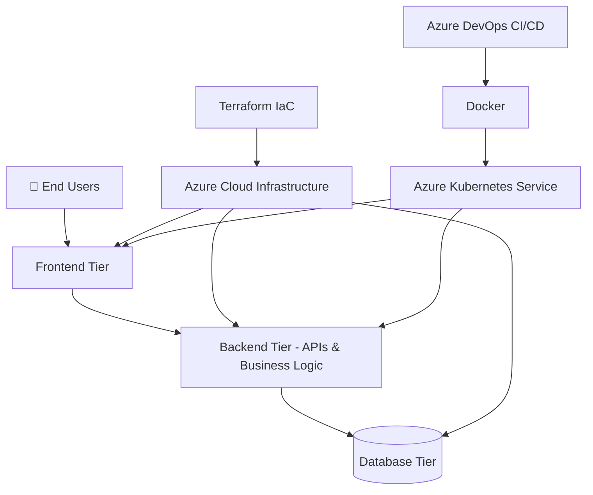

<div align="center">

<!-- HERO BANNER -->


# 👋 Hi, I'm Assad Imam

### Azure DevOps Engineer | Cloud Infrastructure | DevSecOps

<p>
  <a href="https://github.com/assadimam780">
    
  </a>
  <a href="https://www.linkedin.com/in/assad-imam-a9b0001a7/">
    
  </a>
  <a href="mailto:assadimam77@gmail.com">
    
  </a>
  
</p>

📍 Bangalore, India

</div>

---

## 💎 About Me

I'm an **Azure DevOps Engineer with 1+ year of professional experience**, specializing in cloud infrastructure automation, Infrastructure as Code, CI/CD pipelines, containerization and DevSecOps.

- ☁️ Building and managing infrastructure on Microsoft Azure.
- 🏗️ Automating cloud provisioning using Terraform.
- ⚙️ Developing CI/CD pipelines with Azure DevOps and YAML.
- 🐳 Working with Docker, Kubernetes and AKS.
- 🔐 Integrating security scanning into infrastructure and deployment workflows.
- 🌐 Implementing secure Azure networking and cloud architecture.

**My goal:** Build secure, scalable and reliable cloud infrastructure through automation.

---

## 🚀 Technical Expertise

<div align="center">

### ☁️ Cloud & Infrastructure


### ⚙️ DevOps & CI/CD


### 🐳 Containers & Orchestration


### 💻 Programming & Scripting


</div>

---

## 📊 Professional Impact

<div align="center">

<table>
<tr>
<td align="center" width="33%">
<h1>80%</h1>
<b>Less Manual Provisioning Time</b>
<br/>
<sub>Reusable Terraform Modules</sub>
</td>
<td align="center" width="33%">
<h1>90%</h1>
<b>Reduced Release Cycle Time</b>
<br/>
<sub>Azure DevOps Automation</sub>
</td>
<td align="center" width="33%">
<h1>95%</h1>
<b>Faster Releases</b>
<br/>
<sub>Secure Software Delivery Framework</sub>
</td>
</tr>
</table>

</div>

---

## 🔐 DevSecOps & Security Automation

I believe security should be integrated into every stage of infrastructure provisioning and application delivery.

| Security Tool | Purpose |
|---|---|
| 🔍 Tfsec | Terraform security scanning |
| 🛠️ TFLint | Terraform code validation |
| 🔐 TruffleHog | Secret detection |
| 🏗️ Terraform | Infrastructure automation |
| ⚙️ Azure DevOps | Automated security workflows |

### 🔄 DevSecOps Workflow

```text
       Developer
           |
           ▼
      Git Repository
           |
           ▼
   Azure DevOps Pipeline
           |
           ▼
    Terraform Formatting
           |
           ▼
    Terraform Validation
           |
           ▼
        TFLint
           |
           ▼
         Tfsec
           |
           ▼
      TruffleHog
           |
           ▼
    Terraform Plan / Apply
           |
           ▼
     Azure Infrastructure
```

---

## ☁️ Microsoft Azure Skills

<div align="center">

| Category | Technologies |
|:---|:---|
| **Cloud** | Microsoft Azure, Azure Landing Zone |
| **Networking** | VNet, VNet Peering, NSG, VPN Gateway |
| **Connectivity** | Bastion Host, NAT Gateway, Route Tables |
| **Traffic Management** | Application Gateway, Load Balancer |
| **Compute** | Azure Virtual Machines |
| **Containers** | AKS, ACR, Docker |
| **Monitoring** | Azure Monitor |
| **Automation** | Azure CLI, Terraform |

</div>

---

## 🏗️ Terraform & Infrastructure as Code

Automating cloud infrastructure with reusable Terraform modules and Infrastructure as Code practices.

<div align="center">

```text
             TERRAFORM
                 |
       ┌─────────┼─────────┐
       |         |         |
       ▼         ▼         ▼
   NETWORKING  COMPUTE  SECURITY
       |         |         |
       └─────────┼─────────┘
                 |
                 ▼
          MICROSOFT AZURE
                 |
                 ▼
       CLOUD INFRASTRUCTURE
```

</div>

### Terraform Workflow

```bash
terraform init
terraform fmt
terraform validate
terraform plan
terraform apply
```

**Key Areas:** Reusable Modules • Remote State • Multi-Environment Provisioning • Infrastructure Validation • Automated Deployment

---

## 🔄 CI/CD Pipeline Automation

<div align="center">

```text
       Git Repository
              |
              ▼
       Azure DevOps
              |
              ▼
        YAML Pipeline
              |
              ▼
       Build & Validation
              |
              ▼
        Security Scan
              |
              ▼
         Docker Build
              |
              ▼
   Azure Container Registry
              |
              ▼
     Kubernetes / AKS
              |
              ▼
     Application Deployment
```

</div>

**Tools:** Azure DevOps | Azure Pipelines | YAML | Git | Terraform | Docker | AKS | ACR

---

## 🏢 Featured Project 01 — UAE Real Estate Cloud Platform

<p align="center">
  
  
  
</p>

### 📌 Project Overview

Worked on a UAE-based Real Estate Platform built using a **3-Tier Application Architecture** consisting of Frontend, Backend and Database layers.

My responsibility was to handle DevOps activities, manage Azure infrastructure, automate provisioning using Terraform, maintain CI/CD pipelines and support application deployments.

### 🏗️ Application Architecture



### 👨‍💻 My Responsibilities

- ☁️ Provisioned and managed Azure infrastructure using Terraform.
- 🏗️ Created and worked with reusable Terraform modules.
- ⚙️ Built and maintained Azure DevOps YAML CI/CD pipelines.
- 🐳 Containerized application workloads using Docker.
- ☸️ Supported application deployments on Azure Kubernetes Service (AKS).
- 🌐 Worked with Azure Networking, Application Gateway and Load Balancer.
- 🔐 Configured and worked with Bastion Host and NAT Gateway.
- 🛡️ Integrated Tfsec, TFLint and TruffleHog into DevOps workflows.
- 📊 Used Azure Monitor for monitoring and troubleshooting.
- 🤝 Coordinated with frontend, backend and database engineering teams.

### 🛠️ Project Technology Stack

<p align="left">

</p>

`Azure` `Terraform` `Azure DevOps` `YAML` `Docker` `AKS` `ACR` `Azure Networking` `DevSecOps`

---

## 🏗️ Featured Project 02 — Enterprise Cloud Foundation Platform

**Architecture:** Azure Landing Zone | Hub-and-Spoke

- Designed Azure Hub-and-Spoke infrastructure architecture.
- Developed reusable Terraform modules.
- Configured Network Security Groups and Route Tables.
- Implemented Bastion Host for secure remote access.
- Automated cloud infrastructure provisioning.
- Supported secure cloud connectivity and environment management.

**Technologies:** `Azure` `Terraform` `NSG` `VNet` `Bastion` `VPN Gateway`

---

## 🔥 Featured Project 03 — Secure Software Delivery Framework

**Architecture:** Azure DevOps | Docker | AKS | DevSecOps

- Built Azure DevOps CI/CD pipelines using YAML.
- Automated application build and deployment workflows.
- Integrated Docker containerization.
- Supported Kubernetes and AKS deployments.
- Used Azure Container Registry.
- Integrated infrastructure security scanning.
- Improved software release efficiency through automation.

**Technologies:** `Azure DevOps` `Terraform` `Docker` `AKS` `ACR` `Tfsec` `TFLint` `TruffleHog`

---

## 💼 Professional Experience

### 🚀 Azure DevOps Engineer

**Bytonius Pvt. Ltd.** | Bangalore, India

📅 July 2025 – August 2026

- Designed and deployed Azure cloud infrastructure using Terraform.
- Built reusable IaC modules, reducing manual provisioning time by 80%.
- Developed Azure DevOps YAML pipelines, reducing release cycle time by 90%.
- Integrated Tfsec, TFLint and TruffleHog into CI/CD workflows.
- Automated infrastructure provisioning and validation using Terraform and Azure CLI.
- Containerized applications using Docker and supported AKS workloads.
- Configured Azure networking and secure connectivity.
- Supported deployment troubleshooting and release activities.

---

## 🏆 Certifications & Achievements

### Certifications

- Microsoft Azure Administrator Associate — AZ-104 (In Progress)
- Azure DevOps Engineer Expert — AZ-400 (In Progress)

### Awards

🏅 **Quarterly Excellence Award** — DevSecOps Transformation Initiatives

🏆 **Client Appreciation Award** — Secure, Scalable and Cost-Optimized Azure Delivery

### Education

🎓 **B.Tech — Data Science**

KCC Institute of Technology and Management

---

## 🌱 Currently Exploring

<div align="center">

</div>

- ☸️ Advanced Kubernetes
- ☁️ Advanced Azure Cloud Architecture
- 🤖 AIOps and AI-driven DevOps
- 🔐 Advanced DevSecOps
- 🏗️ Platform Engineering
- 🔗 MCP and RAG Architectures

---

## 📈 GitHub Statistics

<div align="center">


<br/><br/>


</div>

---

## 📫 Let's Connect

<div align="center">

<a href="mailto:assadimam77@gmail.com">

</a>

<a href="https://www.linkedin.com/in/assad-imam-a9b0001a7/">

</a>

<a href="https://github.com/assadimam780">

</a>

<br/><br/>


<br/><br/>


### 🚀 Azure DevOps Engineer | Cloud Automation | Infrastructure as Code

**"Automate. Secure. Deploy. Repeat."**

</div>
